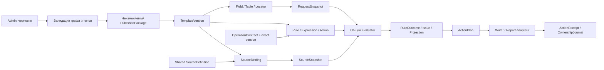

# Универсальная модель конструктора: предложение PR-01

Статус: **архитектурный проект для ревью, не утверждённая реализация**. Основание — main `2a04ae7c2cd92c20b470d5a4aa0c39f8320188b3`, объединённый PR-00 и [ТЗ v0.15](https://docs.google.com/document/d/1skCtOzRTq4_wuNNkZHSaeyWsh_sf_RjYq1OKDezmBKM/edit). Утверждены ранее ADR-001…ADR-007; новые решения ниже предлагаются. Только включительный смысл диапазона уже разрешает соответствующее расхождение старых требований. Q-01…Q-11 не закрываются этой моделью.

Цель — через Admin создать, скопировать и изменить любую **выразимую зарегистрированными типами и операциями** проверку любого поддерживаемого Excel-шаблона. Добавление нового алгоритма в библиотеку — отдельная разработка; его выбор, параметры и все бизнес-условия — данные. Название NETWORK_ACCESS не является условием исполнения в ядре.

## 1. Границы и связи

Resolver читает Excel, source adapter получает локальные данные, операция вычисляет значение, правило принимает бизнес-решение, Planner разрешает адреса/конфликты, Writer меняет книгу. `Issue` и `ActionIntent` не содержат живой `Range`, `Workbook`, ссылку на VBA-макрос или исполняемую строку.

## 2. Идентичность и версии

Предложение: машинный идентификатор сущности — неизменяемый ключ `[A-Z][A-Z0-9_]*` в своём namespace проекта; ссылка хранит **тип сущности + ID**, не DisplayName. В опубликованном пакете дополнительно фиксируются версия и digest. `NETWORK_ACCESS/NET_INITIATOR_IP_ACCESS` — пример ключей данных, не имя процедуры. Историческое `NET.INITIATOR_IP_ACCESS` хранится в `LegacyRuleId`, а 26 дополнительных имён — в `LegacyPath`. Новые ID не переиспользуются после архивации. Это предложение формата, не миграция существующих проверок.

`EntityVersion` — неизменяемый номер редакции внутри истории сущности; `PackageVersion` — версия совместимого набора; `SchemaVersion` — формат сериализации; `OperationVersion` — семантика алгоритма. Эти четыре версии не заменяют друг друга. Полная ссылка при публикации: `(EntityKind, EntityId, EntityVersion)`, для операции `(OperationId, exact SemVer)`. Runtime не выбирает «последнюю подходящую» операцию сам.

DisplayName, описание, язык и сортировка меняются без разрыва ссылок. Изменить машинный ID = создать новую сущность и выполнить явную миграцию ссылок в черновике. Копия получает новые ID всех принадлежащих ей объектов и таблицу remap внутренних ссылок; ссылки на общие источники/операции остаются общими, если пользователь не выбрал их независимые копии.

## 3. Авторские сущности

| Сущность | Обязательные данные и связи | Инвариант |
| --- | --- | --- |
| TemplateDefinition / TemplateVersion | TemplateId, EntityVersion, DisplayName, category, status, RecognitionDefinition, FieldIds, TableIds, RuleIds, BindingIds, ProjectionIds, OutputProfileIds, SupportedProfiles, sample fingerprint | Версия задаёт согласованный набор, а не набор mutable указателей |
| RecognitionDefinition | SheetSelectors, признаки/веса/порог, правила поиска title/marker/name, версия формы, ambiguity policy | Несколько подходящих шаблонов/листов → диагностированная неоднозначность, не случайный первый |
| FieldDefinition | FieldId, DisplayName, DataTypeRef, LocatorId, NormalizationPipeline, Requiredness как отдельное правило, sensitivity | Обязательность не зашивается в тип или координату |
| LocatorDefinition | SheetSelector, strategy A1 / DefinedName / TableColumn / LabelOffset, anchor matcher, search bounds, offset, merge read/target policy, cardinality | 0 / 1 / много совпадений различимы; порядок fallback задан данными |
| TableDefinition / ColumnDefinition | TableId, ColumnIds/types/locators, header selector, boundary strategy, row inclusion predicate, hidden-row policy, merge interpretation, primary columns, end marker / max bounds | Пустая строка внутри диапазона не обязана завершать таблицу |
| SourceDefinition | Общий SourceId, schema/version, adapter kind, path-selection policy, allowed roots, table/columns, keys, freshness, sensitivity, indexes, update permissions, profiles | Источник независим от шаблона; нет обхода неизвестных папок |
| SourceBinding | BindingId, SourceRef, column/parameter mapping, declared required dependencies, expected cardinality, normalization, snapshot policy | Имена файлов/листов/колонок меняются здесь, не в операции |
| NamedExpression | ExpressionId, typed parameters, return type, AST, dependencies, description | Чистое вычисление; граф без циклов, aliases лексические |
| RuleDefinition | RuleId/version, LegacyRuleId, scope, profiles, gate, local bindings, clauses, exception policy, order/priority, dependencies, ActionRefs, decision requirements | Все условия и действия открываются в Admin, нет скрытого шаблонного callback |
| ClauseDefinition | ClauseId, kind ASSERT / EMIT, predicate AST, ForEach/scope binding, outcome on false/true, message/action bindings | ASSERT: TRUE удовлетворено, FALSE замечание; EMIT: TRUE публикует результат, FALSE молчит |
| OperationContract | OperationId/version, signatures, input constraints, parameter schema, return type, states/diagnostics, resource budget, determinism, binding capability | Библиотечный алгоритм без ссылок на шаблон и его Excel-адреса |
| ParameterProfile | ProfileId/version, OperationContractRef, typed ParameterSchema values, normalization/grammar/limit policy, migration metadata | Не исполняемый текст; версия и значения фиксируются пакетом, UI редактирует только объявленные параметры |
| MessageDefinition / RoutingDefinition | MessageId, локализованные templates, typed placeholders; audience × channel, severity mapping, visibility, grouping/dedup keys | Вычислительный факт, severity, получатель и видимость независимы |
| ActionDefinition | ActionId, trigger status, target expression, payload expression, audience/channel, merge/conflict policy, output destination, priority | Адрес сообщения может отличаться от поля чтения |
| ProjectionDefinition | ProjectionId, typed AST над snapshots/outputs, schema выходных строк, ordering, provenance, dependencies | Создаёт набор данных отчёта, не книгу и не новые бизнес-проверки |
| ReportDefinition / OutputProfile | ReportId, именованные sheets/columns/format, projection refs, joins/grouping, save policy, audience, source-view selection | Устройство сводки — редактируемая спецификация; алгоритм не знает «Superset» |
| DecisionRequirement | DecisionId, external question Q-xx/ADR, allowed alternatives, affected paths, state UNRESOLVED / ACCEPTED, evidence | Наличие варианта модели не означает принятия бизнес-правила |

Служебные параметры схемы, limit-ы и права не являются обходом UI: Admin видит допустимый диапазон, тип и последствия. Разрешённые для Runtime изменения путей/свежести источников хранятся как `LocalSourceBindingOverride`, не изменяют опубликованные условия. Runtime может менять только свойства, явно разрешённые пакетом; effective override включается в RunContext.

## 4. Excel Resolver и динамическая строка

`RequestSnapshot` содержит WorkbookSessionId, file identity, SheetInstanceId, resolved schema/version, CellValue envelopes, исходный текст/тип, normalized values, immutable `CellRef` и merge topology digest. `CellRef` хранит sheet identity + area + anchor + locator origin, но не доверяет одному отображаемому имени листа. Если книга/структура изменилась между чтением и записью, Planner повторно проверяет topology и требует новый запуск при несовпадении.

`RowRef` = TableId + RunId + logical row key + physical row references; он стабилен внутри snapshot, не обещает постоянный Excel row number после вставки строк. `ColumnRef(alias, ColumnId)` относится только к выбранной строке. Динамический key из данных применяется для join только при явно заданной уникальности; одинаковый asset id/IP не делает две физические записи автоматически одной строкой.

Merge-политики — данные TableDefinition: `primary columns` определяют существование записи; общий одинаковый вертикальный блок всех primary может считаться одной логической строкой; частичные merge наследуются по physical row с сохранением provenance; вспомогательный merged reason/system/role не создаёт пустую запись. Между boundary и resolver limits продолжается поиск после пустых spacer-строк. Ненайденный header = MISSING; неоднозначный = CONFLICT; превышенный предел = LIMIT. Различия v1 physical/whole-merge трактовок остаются вариантами до Q-04/Q-08, а не новым специальным NETWORK_ACCESS-экстрактором.

Список стратегий конечен и зарегистрирован, свободный VBA locator запрещён. Если форма требует неизвестного алгоритма извлечения, это честный adapter capability gap с отдельным контрактом и разработкой. Выбор ячейки пользователем сохраняет locator и показывает обработку MergeArea, а не вставляет текущий ActiveCell в правило.

## 5. Источники, зависимости и кэш

Source adapter по Binding получает read-only snapshot и проверяет схему до предоставления строк. Политика выбора файла детерминирована: явно заданный путь либо разрешённая маска + критерий версии/даты + tie policy. Последняя битая выгрузка не заменяется молча старой. Любой разрешённый fallback отображает выбранный путь/version и решение в trace; допустимость этого поведения — Q-02/Q-10.

Чтение XLSX/XLSM не разрешает запуск макросов источника, обновление внешних ссылок или произвольный recalc. Adapter фиксирует режим cached values/formulas, отключает выполняемые внешние зависимости и сообщает невозможность безопасного snapshot. Выражения и операции не могут обойти adapter через путь/макрос из ячейки.

Ключ общего кэша: SourceId, effective path/file identity, schema/normalization digest, content version/digest, adapter/index version. Size+mtime — быстрый признак, не достаточное доказательство неизменности; для одинаковых size+mtime нужен fingerprint либо инвалидирование согласно явной политике. Открытая грязная книга требует замороженного in-memory snapshot с отдельным revision token или отказа; нельзя выдавать её за дисковую версию. Замена файла во время snapshot → UNAVAILABLE/diagnostic retry, не смесь двух версий.

Общий граф зависимостей включает поля, источники, операции, named expressions, rules, projections и output profiles. Циклы запрещены. Gate с short-circuit не открывает источник неисполняемой ветви. FIRST_LINE не получает зависимости координаторской проекции. При старте Excel читаются только метаданные. Неудача обязательного чтения даёт CANNOT_EVALUATE для затронутых экземпляров правила и incomplete run, а не PASS.

## 6. Правило, исключение и приоритет

Gate определяет применимость; scope создаёт экземпляры document/field/row/table/group. Далее Let вычисляет общие значения, clauses создают независимые findings. Правила могут совместно использовать NamedExpression, но не парсить отформатированный Message другого правила. Зависимость от результата другого RuleId допускается только через объявленный typed OutputRef в DAG; предпочтительны общие выражения для вычислений, не повторное выполнение источника.

ExceptionDefinition — обычное типизированное условие с эффектом SUPPRESS_SELECTED_FINDING, REQUIRE_APPROVAL либо REPLACE_ACTION и указанным scope/ключом. Оно не удаляет техническую диагностику обязательного вычисления и не превращает ошибку источника в разрешение. Несколько совпадений обрабатываются явным selection policy: collect-all, max-priority, max-specificity; порядок числового priority задаётся (большее выше), затем specificity, при равенстве incompatible outputs → CONFLICT. Порядок строк источника не является скрытым последним приоритетом. Для совместимости last-row-wins может быть явной политикой данных, но не default и не самовольно принятое решение Q-05.

Hostname: scoring и отбор structured service/group отделены от сбора всех применимых approvals/comments. IP policy: selector priority, union allow, union deny, difference/coverage — отдельные выражения. ALLROWS: Filter связанных по matched key строк + All(predicate) + явный непустой guard. Ни один из этих случаев не требует Rulebook-specific evaluator. Подробные схемы — в [матрице выразительности](expressiveness-matrix.md).

## 7. Результаты, действия и публикация в Excel

| Объект Runtime | Данные | Назначение |
| --- | --- | --- |
| RunContext | RunId, PackageDigest, profile, clock/date/locale snapshot, request/source revision tokens, effective overrides, budgets | Один детерминированный контекст, без тайного Now/ActiveWorkbook |
| EvalResult<T> | state, value только при OK, DiagnosticId/details, provenance, trace ref | Контракт вычисления; [точная семантика](expression-model.md) |
| RuleOutcome | RuleRef, ClauseRef, InstanceKey, status, findings, typed output bindings, evaluation completeness, decision provenance | Статусы PASS / FAIL / WARN / INFO / NEEDS_APPROVAL / NOT_APPLICABLE / CANNOT_EVALUATE |
| Issue | IssueKey, Rule/Clause/Instance refs, category BUSINESS / TECHNICAL, raw/effective severity, message parameters/templates, logical TargetRefs, audience/channel bindings, source provenance | Вычисленный факт; не текстовое редактирование Excel |
| ActionIntent | ActionRef, origin = IssueRef или ProjectionRef, target refs or projection, typed payload, output scope, policy refs | Планируемое действие, ещё без побочного эффекта; успешный отчёт не требует фиктивного issue |
| ActionPlan | RunRef, canonical targets, deterministic action order, expected preconditions, journal entries, report datasets, conflicts | Только после нормализации merge и сверки snapshot |
| ActionReceipt | ActionInstanceKey, APPLIED / SKIPPED / CONFLICT / FAILED / ROLLED_BACK, actual target, saved output path+digest если есть, diagnostic | Ошибка записи не меняет вычисленный FAIL на PASS и не скрывается |
| OwnershipJournal | BookIdentity, Run/Package/Action ids, before/after digests, owned note blocks/rules, reversible property snapshot, progress state | Позволяет корректно снять только собственные изменения |

IssueKey строится из RuleId+ClauseId+logical instance+finding code+provenance key, не Message. Дедупликация разных физических ошибок по одинаковому тексту запрещена без явной policy; UI grouping не меняет первичные issues и реальный count. Run completeness, business status и output status раздельны: `PASS + output FAILED` не считается успешным сквозным запуском.

ActionInstanceKey = RunId + ActionDefinitionRef + origin key + canonical target/output scope + occurrence key. Это идентичность одного применения на строку/цель/артефакт, не только общей ActionId. Retry одного instance сверяет journal/receipt и не добавляет второй note/report row. Lifecycle журнала INTENT/PENDING/APPLIED/RECOVERY_REQUIRED отличается от terminal receipt; crash между мутацией и acknowledgement оставляет неизвестное состояние, которое сравнивается с before/after, а не объявляется APPLIED или автоматически повторяется.

Статически известная несовместимость Writer capability блокирует публикацию требующего её пакета. Защищённый/изменённый target конкретной runtime-книги может обнаружиться позже: receipt FAILED с CAPABILITY_UNSUPPORTED и incomplete output, без изменения вычисленного RuleOutcome. Если нельзя вычислить сам payload/target, это non-OK EvalResult планирования с diagnostic, не попытка частичной мутации. До первого изменения обязательно сохранение полного требуемого before-state; невозможность захвата формата/заметки запрещает эту мутацию.

Planner сначала нормализует ВСЕ TargetRefs к канонической MergeArea, затем объединяет сообщения и выбирает цвет (по default ERROR > WARNING > INFO, предложение настройки палитры/приоритетов). Все сообщения остаются доступны, ни одна более поздняя INFO не стирает ERROR. Условие можно направить на несколько полей; NoCell сохраняет замечание без заливки. `NEEDS_APPROVAL` — отдельный исход, его цвет/каналы задаются данными; это не автоматически ошибка инициатора.

Journal идентифицирует собственные изменения по ID и ожидаемому состоянию; совпавший цвет или строка «AccessTools» недостаточны для владения. Перед очисткой compare-before-restore: при чужом изменении с момента применения — CONFLICT, никаких догадок/стирания. Журнал должен учитывать поэлементную исходную заливку, CF и его приоритет, формат/содержимое пользовательского note; не только один цвет anchor. Если требуемое состояние нельзя безопасно сохранить/восстановить на данной версии Excel, capability gate запрещает эту мутацию, оставляя результаты в отдельном отчёте. Выбор физического хранилища журнала и поддержка threaded comments — открытое инженерное решение, не обещание доказанной транзакционности.

Новый запуск планирует diff owned actions предыдущего run: снимает устаревшие/отключённые, обновляет текущие и сохраняет чужое; не очищает всё до получения нового результата. Перед каждым шагом durable journal фиксирует намерение и before-state, после — receipt. При сбое отменяются подтверждённо собственные шаги; при неопределённом состоянии — recovery/CONFLICT, дальнейшая запись заблокирована. Детальный пользовательский сценарий и ограничения — [admin-workflows](admin-workflows.md).

Audience отвечает, кому предназначена информация; channel — note/results/user report/coordinator report/source view; ExecutionProfile отвечает за выполнение и загрузку источников. Примечание в общей книге физически доступно всем, у кого есть книга: audience не является защитой секретности. Для различающегося доступа нужны отдельные выходные артефакты/проекции с исключёнными данными, а не скрытая колонка. Чувствительные значения маскируются в trace по умолчанию.

## 8. Проекции и результирующие книги

Источник отчёта — Request/SourceSnapshot и typed rule outputs. Не вычислять бизнес-результат, читая уже перерисованные временные Excel-ячейки. Generic ReportDefinition задаёт sheets, columns, order, types, width/wrap, row grouping, distinct aggregation, source-row links и глобальные сообщения. Runtime может построить представление по запросу без повторного запуска правил; оно закреплено за RunId.

Для NETWORK_ACCESS редактируемая проекция может связать уникальный entry key с видимыми matched SourceRowRefs и сохранить 11 полей сводки из PR-00; поддержка/SКУФ — column bindings, не константы операции. Hostname при неоднозначности задаётся OP_UNIQUE_VALUE с explicit ambiguous branch, остальные значения — distinct+join. Not-found entry сохраняется даже без строки источника. Степени ANY/PARTIAL/FULL и непокрытая часть не смешиваются: ADR-007 запрещает назвать весь диапазон найденным по двум крайним адресам. Сохранение исторического matched-any канала и точные названия статусов требуют Q-06; полноту нельзя скрыть старым словом «НАЙДЕН».

Сводка, source view и глобальные инструкции — отдельные проекции. Где показывать бывшее «Общее», остаётся Q-09. Схема не ограничивает число таких проекций и не навязывает решение. Имена временных/долговременных файлов, место сохранения и безопасная обработка существующего файла — OutputProfile. Save проверяет фактический результат и возвращает путь только после успешного receipt; исходная заявка автоматически не сохраняется, source по умолчанию read-only. Опциональное обогащение внешнего источника требует отдельного capability, явного действия и решения, не включается скрыто в lookup.

Если пакет обязан публиковать глобальные инструкции, соответствующая Projection/OutputProfile имеет required DecisionRequirement(Q-09): отсутствие согласованного канала блокирует publish, а не молча отбрасывает dataset. Историческое автоматическое изменение схемы Rulebook при запуске (DB.schema) не покрывается read-only SourceBinding: для эквивалентного побочного эффекта нужен отдельный согласованный SourceMigration action contract. До этого архитектурный action gap остаётся открытым, вычисление запрета БД от него независимо.

## 9. Жизненный цикл, ссылочная целостность и миграции

Черновик имеет DraftId, base PackageDigest и изменяемые ревизии; сохранить неполную работу разрешено с диагностикой. Publish создаёт новый неизменяемый пакет только после resolution всех ссылок/версий, type/scope/cycle/capability/source-schema проверок, review требуемых DecisionRequirement и golden expectations. Эксплуатационные файлы данных не обязаны включаться в пакет: пакет фиксирует схемы/политики, запуск — фактические source revisions. Manifest/digest обеспечивает целостность, но не аутентичность доверенного автора без отдельной подписи/политики распространения.

Draft → VALIDATED → PUBLISHED → RETIRED — состояния версии; enabled/archived — отдельные состояния сущностей. Отключение правила прекращает его новые экземпляры и в следующем успешном плане снимает owned actions этого RuleId. Архивирование исключает из новых выборов, но сохраняет исторические ссылки. Физическое удаление запрещено при incoming refs в любом retained draft/package/journal; удаление только через явную миграцию и retention policy.

| Изменение | Проверка / следствие |
| --- | --- |
| Field EMAIL: B8 → D12, имя изменено | Locator version меняется в draft; все Rule/Action FieldRefs сохраняют ID и получают новый адрес после publish; старый package продолжает B8 |
| Тип поля TEXT → DATE | Impact graph показывает сравнения/операции/placeholders; несовместимые refs блокируют publish, автоматического coercion нет |
| Удаление SOURCE_ID | Incoming refs binding/index/projection блокируют hard delete; отключение источника не превращает dependent rule в PASS |
| Копирование шаблона | Новый namespace/IDs и remap owned refs; общие operations/sources остаются pinned shared refs |
| Rule archived | История и provenance доступны; новый пакет не исполняет; очистка только своего прежнего вывода |
| Operation major update | Новая exact version + migration mapping; explain/golden diff; старый пакет не заменяется автоматически |
| Rollback | Атомарное переключение active package pointer на проверенный совместимый digest; текущий run завершает свою pinned версию; источники/Excel пользовательские данные назад не откатываются |

Если текущая книга размечена новым package, откат пакета не означает немедленную слепую запись старых значений. Следующий run использует journal и проверку before/after; сохранившиеся конфликтные изменения предлагаются к восстановлению отдельно. Изменение shared source schema требует совместимости всех потребителей; package validator рассматривает транзитивный граф, а не только открытый шаблон.

## 10. Выразимость и предел доказательства

17 правил и 26 дополнительных путей представлены как структурные схемы в [expressiveness-matrix](expressiveness-matrix.md). Второй пример EQUIPMENT_RETURN использует те же Field/Table/Source/AST/Action сущности без IP-источников. Подробные типы — [expression-model](expression-model.md), операции — [operation-catalog](operation-catalog.md), действия администратора — [admin-workflows](admin-workflows.md).

В PR-01 нет сериализованных рабочих правил, VBA, форм или адаптеров. Структурная представимость не равна успешной сборке, созданию через UI или Excel-паритету. Неизвестный source schema, непринятый Q-policy, неподдерживаемый Excel capability или неограниченный алгоритм остаются явными препятствиями к публикации соответствующего сценария. Решения/альтернативы и дальнейшие гейты — [pr01-architecture-findings](pr01-architecture-findings.md).
